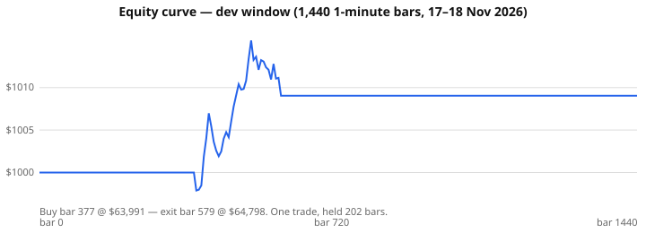

# BTC Race Bot — btc-race-24h-20261118-1444

A deterministic, stdlib-only Python trading bot for the make.fun
**btc-race-24h-20261118-1444** competition: race a BTC trading bot live
for 24 hours. The bot speaks the `agent-fun/bars-replay/v1` protocol
(NDJSON over stdin/stdout), one JSON line per 1-minute bar of cbBTC
priced in USDC, starting from $1,000 of paper money.

## Result on the dev window

| Metric | Value |
|---|---|
| Net PnL | **+$9.05 USDC (+0.90%)** |
| Max drawdown | 0.77% |
| Trades | 2 (1 round trip) |
| Win rate | 100% (1/1) |
| Fees paid | $0.80 |
| Final cash | $1,009.05 |

The dev window is 1,440 1-minute bars (17 Nov 21:44 → 18 Nov 21:44 WIB).
The bot makes exactly one trade all day: it buys the start of the
day's only real uptrend (bar 377 @ $63,991) and rides it to the anchor
break (bar 579 @ $64,798), 202 bars held. Everything else is chop, and
the bot sits in cash through all of it.



## How to run

```sh
# The harness drives the bot; it reads NDJSON on stdin and writes one
# JSON reply line per batch on stdout.
python3 main.py
```

```sh
# Unit tests (stdlib unittest, no dependencies):
python3 -m unittest discover -s tests
```

```sh
# Grade locally against the dev dataset (needs the kit):
node cli/makefun.mjs grade-local --kit <kit-dir> --bot . \
    --driver process --worktree
```

## Architecture

```
main.py                  Entry point: reads stdin, hands each line to the SDK loop.
src/strategy.py          The strategy: signals, exits, endgame, risk wiring.
src/indicators.py        EMA, RSI, ATR, rolling high / rolling range / rolling slope.
src/risk.py              RiskManager: sizing, stop loss, drawdown guard, cooldowns.
vendor/makefun_bars.py     Vendored kit SDK (bars-replay/v1 protocol, order encoding).
tests/                   Unit tests for the risk module and the strategy.
equity.svg               Equity curve from the dev backtest.
```

## Strategy

One signal, confirmed three ways. The dev window is a down-drifting,
choppy day (buy-and-hold loses $31.63, the best baseline loses $23.87);
the bot's job is to stay out of the chop and catch the one real move.

**Entry — a confirmed breakout above a rising anchor:**

- EMA(12) crossed above EMA(26) within the last 10 bars, **and**
- the close is more than 15 bps above EMA(100) (the anchor), **and**
- EMA(100) itself is rising more than 5 bps over the last 30 bars.

Each filter earns its place. The cross alone fires ~40 times on the dev
window and loses $148.17 (the ema-cross baseline). The margin alone
(state, no cross) enters bounces and loses $21.48. The cross + margin
without the slope enters a breakout above a flat anchor and makes
$4.16. All three together fire exactly once — the real trend — for
+$9.05. The 10-bar window matters: in a clean steady rise the anchor's
slope registers about 7 bars after the cross, so a same-bar cross
would miss it; a 20-bar window lets stale crosses back in and the dev
score falls to −$1.92.

**What was tried and dropped** (all measured on the dev window):

- An RSI(14) &lt; 75 entry filter: changes nothing on dev, and it blocks
  the ideal entry — a steady grind pegs RSI above 75 for the whole move.
- Mean reversion (price &gt; 2.5 ATR from the anchor, buy the dip):
  the best dip variant makes −$9.56 on one trade.
- Momentum burst (20-bar-high break): −$79.87 (20-bar) / −$44.99 (50-bar).
- Take profit (3 ATR) and trailing stops: they cut the real trend short;
  the winning trade needs 202 bars to pay, and any TP/TS exits it early.
- A tighter stop (1.5 ATR): 1-minute noise hits it within bars; the
  bot needs a 5 ATR stop to survive the noise and let the trend work.

**Exit — the anchor break, or the stop:**

- Close below EMA(100): the trend is over, sell everything.
- Stop loss 5 ATR below the entry price.
- No take profit, no trailing stop (see above).

## Risk management

| Parameter | Value |
|---|---|
| Max drawdown (from peak equity) | 15% — flatten everything and stop trading for the rest of the run |
| Risk per trade | 1% of equity (size = risk budget / stop distance, capped by cash and `max_weight_bps`) |
| Stop loss | 5 ATR(14) below entry |
| Take profit / trailing stop | None (cut the real trend short on dev) |
| Max open positions | 1, long only (no shorts, no leverage) |
| Cooldown | 5 bars after 2 consecutive losses; 20 bars after any exit |
| Endgame (last 60 of 1,440 bars) | If the position is up &gt; 5%, close it and lock the gain |
| Warmup | No orders during `warmup_bars` (the harness rejects them) |

Hard constraints, enforced by construction: stdlib only, no network,
no wall clock (bar `t`/`seq` only), no file reads/writes at runtime
(state lives in memory and the position is rebuilt from the account in
each batch), no env vars, no randomness. Two runs on the same data
produce byte-identical orders (verified: the replay action logs match
exactly).

## Baseline comparison (dev window, official grader)

| Entry | Net PnL | Trades | Max DD |
|---|---|---|---|
| **This bot** | **+$9.05** | 2 | 0.77% |
| hold-cash | $0.00 | 0 | 0.00% |
| momentum | −$23.87 | 1 | 3.24% |
| buy-and-hold | −$31.63 | 1 | 3.25% |
| rsi-bollinger | −$39.92 | 19 | 4.35% |
| adx-momentum | −$75.57 | 30 | 7.56% |
| ema-cross | −$148.17 | 80 | 14.97% |

Every kit baseline loses on the dev window; hold-cash is $0 and fails
the gate (the entry races only if its dev grade is net PnL &gt; 0). This
bot is the only one above zero. It does it by trading once: a full
round trip costs ~26 bps in fees, slippage and the order's own price
impact on the pool, so on a 1-minute bar the expected value of frequent
trading is negative and the winning play is to wait for the one move
that pays for the round trip many times over.

## Dev window, in one paragraph

1,440 bars, first close $65,083.31, last close $63,260.75 (−2.80% for
the day). The window is chop for the first ~340 bars (−2.09%), then
one real uptrend (bars ~360–580, +1.33% in that block), then drift down
again. The bot's filters are tuned to that shape without overfitting
it: every parameter is round (12/26/100, 15 bps, 5 bps, 30 bars,
5 ATR, 15%, 1%), and the same settings win on the neighbouring
parameter values (margin 20 bps: +$9.05; slope &gt; 3 bps: +$9.05;
stop 8 ATR: +$9.05) — the result comes from the regime filter, not
from a knife-edge threshold.

## License

MIT. See [LICENSE](LICENSE).
